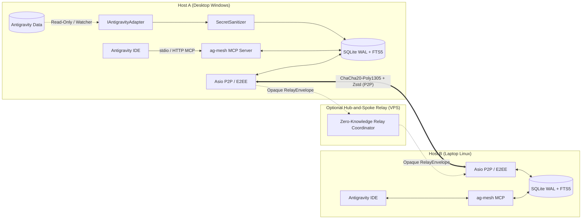

# `ag-mesh` — Multi-Host Connector & Context Sync for Google Antigravity

[](https://github.com/synchron1q/Antigravity-Telepathy_Skill/actions/workflows/ci.yml)
[](LICENSE)

`ag-mesh` is an open-source, zero-cloud C++20 daemon and Antigravity Skill + MCP server that synchronizes chat context, architectural decisions, active workspace state, and task handoffs across 5 or more developer hosts in real time.

## The Problem

When you run independent Google Antigravity instances across multiple machines (Windows desktop, Linux laptop, macOS MacBook, home lab server, cloud builder), every IDE instance lives in an isolated silo. An agent on Host A knows nothing about the bugs solved yesterday on Host C or the uncommitted refactor currently open on Host B.

`ag-mesh` solves this with:
- **Single Compact C++20 Binary:** No Python, Node.js, or JVM runtime dependencies.
- **Zero Cloud / Zero SaaS:** Works over LAN (UDP/mDNS discovery), WireGuard/Tailscale VPNs, or WAN via a self-hosted zero-knowledge Relay Coordinator (`Hub-and-Spoke` or `P2P-Mesh`).
- **End-to-End Authenticated Encryption:** X25519 Noise-style handshake + Ed25519 peer whitelist + Cluster PSK + ChaCha20-Poly1305 AEAD + Zstandard compression.
- **IDE-Safe Read-Only Inspection:** Reads Antigravity SQLite (`mode=ro&immutable=1`), JSONL transcripts, Markdown artifacts, and protobuf state files with zero `SQLITE_BUSY` lock interference, plus a live MCP hook fallback.
- **Secret Sanitization Before Replication:** Regex + Shannon entropy redaction replaces credentials with `[REDACTED:TYPE:HASH4]` before data ever hits the network or shared index.
- **L1 / L2 / L3 Progressive MCP Context:** Prevents LLM context overflow via compact overviews (`cluster_get_overview`), structured digests, FTS5 Cyrillic/Latin search, and paginated lazy message reads.

---

## Architecture



---

## Supported Platforms

| Platform | Architecture | File Watcher Backend | Local IPC | Service Manager |
|---|---|---|---|---|
| **Linux** | `x86_64`, `arm64` | `inotify` | Unix Domain Socket (`0600`) | `systemd --user` / system unit |
| **Windows** | `x86_64` | `ReadDirectoryChangesW` | Named Pipe (`\\.\pipe\ag-mesh-*`) | Windows Service (`sc.exe`) |
| **macOS** | `arm64` (Apple Silicon) | `FSEvents` | Unix Domain Socket (`0600`) | `launchd` LaunchAgent |

---

## 5-Minute Quickstart (Zero-Touch One-Line Bootstrap)

### 1. Install & Initialize Host 1 (Single Command)

**Windows (PowerShell):**
```powershell
irm https://raw.githubusercontent.com/synchron1q/Antigravity-Telepathy_Skill/main/scripts/bootstrap.ps1 | iex
```

**Linux / macOS (Bash):**
```bash
curl -fsSL https://raw.githubusercontent.com/synchron1q/Antigravity-Telepathy_Skill/main/scripts/bootstrap.sh | bash
```
*(Offline install with a locally compiled binary: pass `-LocalBinary .\build\...\ag-mesh.exe` on Windows or `--local-binary ./build/.../ag-mesh` on Linux/macOS.)*

### 2. Open Pairing Window on Host 1 (Auto-detects VPN & LAN IPs)
```bash
ag-mesh pair --uses 4 --ttl 600
```
Prints all detected WireGuard/Tailscale/ZeroTier/LAN endpoints, a 6-digit PIN (`XXX-XXX`), and a one-line invite token `agmesh://join/v1/...`.

### 3. Bootstrap & Join Hosts 2..5 in One Line Each
```bash
# Linux / macOS:
curl -fsSL https://raw.githubusercontent.com/synchron1q/Antigravity-Telepathy_Skill/main/scripts/bootstrap.sh | bash -s -- --join "agmesh://join/v1/..."

# Or on an already-installed host (token or IP + PIN):
ag-mesh join "agmesh://join/v1/..."
ag-mesh join 10.8.0.1 --pin 482-915
```
Host 1 distributes the `cluster_psk` via `PAIR_WELCOME` and automatically introduces all joined nodes to one another via `PEER_GOSSIP` — forming a full 5-node mesh without manual `config.toml` editing!

---

### Manual Build from Source
```bash
cmake --preset linux-release   # or windows-msvc-release / macos-release
cmake --build --preset linux-release --parallel
ctest --preset linux-release --output-on-failure
```

---

## Key CLI Commands

| Command | Description |
|---|---|
| `ag-mesh init [--auto]` | Create `config.toml`, Ed25519 keys, SQLite DB, install Antigravity skill + MCP, and optionally register OS service |
| `ag-mesh pair` | Open pairing window, auto-detect VPN/LAN endpoints, display invite token & 6-digit PIN |
| `ag-mesh join <token\|ip>` | Auto-dial VPN/LAN routes via Happy Eyeballs, exchange keys, save peers, and sync cluster |
| `ag-mesh daemon` | Start background sync, file watcher, P2P/Relay transport, IPC, and MCP HTTP/metrics |
| `ag-mesh mcp` | Run stdio MCP server for direct Antigravity client attachment |
| `ag-mesh probe` | Inspect local Antigravity directories, permissions, and parser compatibility |
| `ag-mesh doctor` | Full self-diagnostics (config, keys, SQLite integrity, peer RTT, MCP registration) |
| `ag-mesh status` | Compact cluster node & session overview (`--json` supported) |
| `ag-mesh search <q>` | Instant FTS5 search across all hosts (supports Cyrillic & Latin) |
| `ag-mesh handoff create\|list\|claim` | Transfer task context, branch, diff, and blockers across hosts |
| `ag-mesh tail` | Live colored stream of replicated events from the running daemon |
| `ag-mesh tui` | Interactive FTXUI terminal dashboard |
| `ag-mesh service install` | Register autostart service (`systemd`, `Windows Service`, or `launchd`) |
| `ag-mesh export` | Atomic snapshot backup (`json` or `markdown`, excludes private keys) |
| `ag-mesh purge <id>` | Tombstone-purge a session across all cluster nodes |

---

## Documentation
- [ARCHITECTURE.md](ARCHITECTURE.md) — Subsystem breakdown, CRDT dataflow, L1/L2/L3 context layering
- [PROTOCOL.md](PROTOCOL.md) — Wire frame layout, handshake FSM, error codes, HLC/CRDT & relay spec
- [SECURITY.md](SECURITY.md) — Threat model, Ed25519/ChaCha20-Poly1305 guarantees, secret sanitization, prompt-injection defense
- [CONTRIBUTING.md](CONTRIBUTING.md) — Coding standards, sanitizers, and test guide
